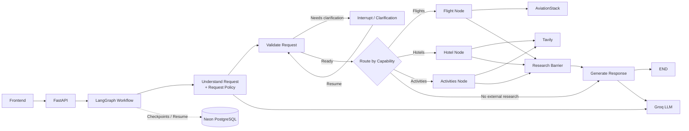

# ✈️ Travora

**Travora** is a LangGraph-based AI travel planner that transforms natural-language travel requests into grounded travel plans using structured request understanding, deterministic validation, capability-based routing, external travel services, and single-pass LLM response generation.

[](https://travora-ai-travel-agent.onrender.com)

## Overview

Travora supports both complete trip-planning requests and focused travel requests.

Examples:

> Plan a 5-day complete trip to France from Athens under $2000.

> Find budget hotels in Milan under $120 per night.

> What are the best things to do in Rome?

Travora converts the user's request into a typed `TravelRequest`, applies deterministic product rules, validates the information required for execution, and runs only the capabilities needed for that request.

Independent flight, hotel, and activity lookups can run in parallel. Their results are synchronized and passed to a **single response-generation step**, avoiding repeated LLM synthesis.

If required information is missing or cannot be resolved, the workflow pauses using a LangGraph interrupt and resumes after the user provides clarification.

---

## Features

- 🧠 Structured natural-language request understanding with Pydantic
- ✅ Deterministic request policy and validation
- 🧭 Capability-based LangGraph routing
- ✈️ Flight information using AviationStack
- 🏨 Hotel research using Tavily
- 🗺️ Destination and activity research using Tavily
- 🔀 Conditional execution of only the required travel capabilities
- ⚡ Parallel execution of independent research nodes
- 🤖 Single-pass LLM synthesis for the final travel response
- 💬 Human-in-the-loop clarification using LangGraph interrupts
- 💾 PostgreSQL-backed LangGraph checkpoint persistence
- 🔁 Interrupt/resume support through `thread_id`
- 🔍 LangSmith tracing for workflow inspection and observability
- 🌐 FastAPI backend
- 🎨 Responsive browser-based frontend
- 📋 Copy generated travel plans
- 📄 Export travel plans as PDF

---

## Tech Stack

### AI / Backend

- Python
- LangGraph
- LangChain
- Groq
- FastAPI
- Pydantic

### External Services

- Tavily Search API
- AviationStack API
- Neon PostgreSQL
- LangSmith

### Frontend

- HTML
- CSS
- JavaScript
- Marked.js
- html2pdf.js

### Development

- `uv` for Python environment and dependency management
- Pytest
- Git / GitHub
- VS Code

---


## Observability

Travora uses LangSmith to inspect workflow execution and LLM behavior.

Tracing is useful for reviewing:

- executed graph paths
- LLM inputs and outputs
- token usage
- latency
- failures
- routing behavior

---

## Architecture

Travora uses a **capability-oriented workflow**, not a fixed linear agent pipeline.



The workflow separates probabilistic LLM work from deterministic application logic:

```text
Natural-language request
        ↓
Structured LLM extraction
        ↓
Deterministic request policy
        ↓
Deterministic validation
        ↓
Capability routing
        ↓
External research when required
        ↓
Single LLM response synthesis
```

A hotel-only request does not execute flight research. A flight-only request does not execute hotel research. An itinerary-only request can go directly to response generation without unnecessary external API calls.

`ITINERARY` remains a domain capability, but it is treated as an **output requirement**, not as a separate LLM generation stage.

---

## Workflow Components

### Understand Request

The request-understanding node converts the user's natural-language request into a typed `TravelRequest` using Groq structured output.

It extracts information such as:

- requested capabilities
- origin
- destination
- trip duration
- budget
- number of travelers
- travel preferences

The LLM does not resolve airport codes or decide whether a location is valid.

---

### Request Policy

After LLM extraction, deterministic application rules normalize the request before validation.

For the current Travora product scope, an end-to-end trip-planning request with both an origin and destination requires:

```text
FLIGHTS
HOTELS
ITINERARY
```

This prevents important routing behavior from depending entirely on probabilistic LLM classification.

---

### Request Validation

Validation is deterministic.

For flight requests, Travora verifies that both origin and destination can be resolved into usable IATA airport codes.

Location resolution supports:

- IATA codes
- cities
- countries

If the user provides an unresolved location such as `"my city"`, Travora does not guess. The workflow pauses and asks for clarification.

---

### Clarification / Interrupt

When required information is missing or unresolved, LangGraph pauses the workflow using `interrupt()`.

Example:

```text
User:
Plan a 5 day trip to Japan from my city.

Travora:
What city, country, or airport will you be departing from?

User:
Athens
```

The clarification answer resumes the same checkpointed workflow and then passes through the normal validation path again before routing continues.

---

### Capability Routing

After validation, Travora deterministically selects only the external capabilities required by the request.

```text
Hotel-only
→ Hotel Node

Flight-only
→ Flight Node

Activities-only
→ Activities Node

Complete trip
→ Flight Node + Hotel Node

Complete trip with sightseeing
→ Flight Node + Hotel Node + Activities Node
```

The `ITINERARY` capability does not require its own graph node. Instead, it tells the response generator to include a day-by-day itinerary.

---

### Flight Node

The flight node consumes validated IATA airport codes and queries AviationStack.

```text
TravelRequest
    ↓
Deterministic location resolution
    ↓
ATH → CDG
    ↓
AviationStack
```

The active workflow does not re-parse the user's raw natural-language request inside the flight node.

AviationStack currently provides flight/status information rather than live airfare pricing.

---

### Hotel Node

The hotel node builds a search query from the structured request and retrieves hotel-related results through Tavily.

Relevant request information such as destination, budget, and preferences can be incorporated into the search.

---

### Activities Node

The activities node retrieves sightseeing, attractions, and destination information through Tavily when the request includes the `ACTIVITIES` capability.

---

### Research Barrier

Flight, hotel, and activity retrieval can execute independently.

The `join_services` node acts as a synchronization barrier before response generation. It does not perform an LLM call.

---

### Generate Response

`generate_response_node` is the workflow's single synthesis step.

It receives the structured request and any available flight, hotel, and activity research, then generates only the sections relevant to the requested capabilities.

If `ITINERARY` is requested, the same generation step creates the day-by-day itinerary. Travora therefore avoids generating an itinerary and then sending that generated text into another LLM call for rewriting.

The response rules instruct the model not to fabricate live prices, availability, flight numbers, provider data, hotel details, or URLs that are not supported by the available research.

---

## LLM Usage

The main workflow has two distinct LLM responsibilities:

```text
1. Request understanding
   Natural language → structured TravelRequest

2. Response synthesis
   Structured request + retrieved evidence → user-facing response
```

Deterministic validation, routing, location resolution, and external API execution do not require an LLM call.

This reduces duplicated generation, token usage, latency, and hallucination surface compared with the previous itinerary-generation + final-response pipeline.

---

## Thread and Checkpoint Lifecycle

LangGraph checkpoints are persisted in Neon PostgreSQL and associated with a `thread_id`.

A thread represents one planning workflow, not a permanent user identity.

```text
New independent request
    ↓
New thread

Clarification required
    ↓
Keep thread

Clarification response
    ↓
Resume same thread

Workflow completed
    ↓
Thread considered closed

Next independent request
    ↓
New thread
```

Completed checkpoints remain persisted, but completed threads are not reused for unrelated requests.

The frontend stores a thread ID only while a workflow is waiting for clarification.

---

## Main Files

`app.py`  
FastAPI application, HTTP endpoints, and API response handling.

`backend.py`  
LangGraph construction, Groq configuration, PostgreSQL checkpointing, and workflow start/resume logic.

`pydantic_models/travel_request.py`  
Typed travel request models, capability definitions, and request-check models.

`llm/request_parser.py`  
Structured LLM extraction of natural-language requests into `TravelRequest`.

`services/request_policy.py`  
Deterministic product rules applied after LLM extraction.

`services/location_resolver.py`  
Deterministic city, country, airport, and IATA resolution.

`validation/request_check.py`  
Deterministic readiness validation before capability execution.

`workflow/state.py`  
LangGraph workflow state definition.

`workflow/routing.py`  
Deterministic conditional-routing logic.

`workflow/nodes.py`  
Request understanding, validation, clarification, external research, synchronization, and response-generation nodes.

`tools/flight_tool.py`  
AviationStack integration for retrieving flight information using resolved airport codes.

`tools/tavily_tool.py`  
Tavily integration used for hotel and activity research.

`templates/index.html`  
Main frontend page.

`static/script.js`  
Frontend API interaction, clarification thread handling, Markdown rendering, copy functionality, and PDF export.

---

## Setup

### 1. Clone the repository

```bash
git clone <your-repository-url>
cd Travora
```

### 2. Install `uv`

The project uses `uv` for environment and dependency management.

If `uv` is not installed:

```bash
pip install uv
```

### 3. Create the virtual environment

```bash
uv venv
```

Windows PowerShell:

```powershell
.venv\Scripts\Activate.ps1
```

macOS / Linux:

```bash
source .venv/bin/activate
```

### 4. Install dependencies

```bash
uv sync
```

---

## Environment Variables

Create a `.env` file in the project root:

```env
DATABASE_URL=your_postgresql_connection_string
GROQ_API_KEY=your_groq_api_key
TAVILY_API_KEY=your_tavily_api_key
AVIATIONSTACK_API_KEY=your_aviationstack_api_key
```

For production, Travora currently uses Neon as its PostgreSQL provider.

Optional LangSmith tracing can be enabled through the standard LangSmith environment variables.

Do not commit `.env` or any credentials.

---

## Run the Application

Start the FastAPI development server:

```bash
uv run uvicorn app:app --reload
```

Then open:

```text
http://127.0.0.1:8000/
```

---

## Tests

Run the complete test suite:

```bash
uv run python -m pytest -v
```

The test suite covers deterministic behavior including location resolution, request readiness validation, request-policy normalization, and workflow routing.

For manual inspection of structured request parsing:

```bash
uv run python -m validation.inspect_request_parser
```

---

## Deployment

Travora is deployed as a Render web service.

Current production infrastructure:

```text
GitHub
   ↓
Render Web Service
   ├── FastAPI
   ├── LangGraph
   └── External API integrations
            ↓
      Neon PostgreSQL
      LangGraph checkpoints
```

Render hosts the application, while Neon provides the persistent PostgreSQL database used by LangGraph checkpointing.

---
