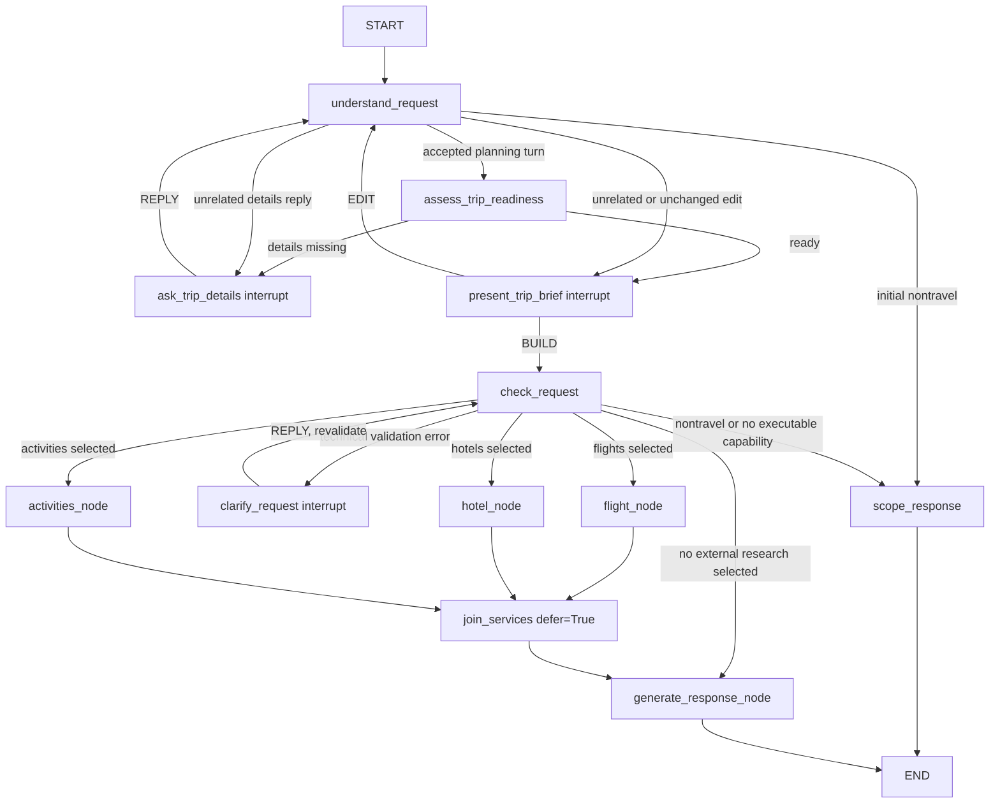

# Travora architecture

The current implementation sections are reconciled against the local 27 November 2026 audit of `feature/conversational-trip-planning` at `ddc43e0`. Historical snapshots, developer-reported checks, agreed decisions and proposals are labeled where relevant. The [evidence vocabulary and S1–S7 sources](DEVELOPMENT.md#evidence) explain their meaning. See the [development baseline](DEVELOPMENT.md#baseline) for verification scope and the [engineering instructions](../AGENTS.md) for change controls.

<a id="b1"></a>

## B1. Product vision, boundaries and requirements

Travora specializes in natural-language travel planning. It supports complete trips and focused requests for flights, accommodation, sightseeing or day-by-day itineraries. The intended experience collects missing requirements, keeps a coherent trip context, presents an editable brief for explicit confirmation, runs relevant research and produces an evidence-aware result that users can copy or export. Users should be able to continue without repeating supplied facts. Independent trips and cancellation should preserve trip isolation. Greeting and out-of-scope handling are the next planned UX improvements. The supported planning lifecycle currently ends after the result.

Examples: “Plan a 5-day complete trip to France from Athens under $2000”. “Find budget hotels in Milan under $120 per night”. “What are the best things to do in Rome?”. An incomplete trip such as “Plan a 5 day trip to Japan from my city” should ask for a valid departure rather than guessing one. Greeting handling and graceful out-of-scope chat are the next planned improvement. Post-generation revisions are not yet part of the supported lifecycle.

Functional requirements: intent classification, structured extraction, deterministic merge/readiness, input constraints, capability-scoped provider research, validation/location resolution, checkpointed interrupt/resume, cancellation, explicit approval, readable output and PDF. Non-functional goals: isolation, predictable transitions, reliable failure handling, grounded provider information, cost/latency control, testability, observability, secure configuration/rendering, maintainability and production deployment. Most advanced reliability and security objectives remain unfinished.

The product scope covers planning and research. AviationStack supplies flight/status data and Tavily supplies web research. Booking, verified ticket inventory and fares, transactions, payments, account-backed saved trips, map/booking cards, complete pricing guarantees and general conversation remain outside this release. Maps, richer providers, post-plan revision and supervisor orchestration remain deferred, with scope changes subject to developer approval.

<a id="b2"></a>

## B2. Historical architecture and evolution

The tutorial baseline was a sequential multi-agent travel planner with a flight lookup, hotel/activities research, itinerary generation and final response. Exact original tutorial file names and topology beyond available diagrams/discussion are not fully recoverable. User reproduced it, made small frontend changes, uploaded GitHub code and deployed to Render by 27 Aug 2026 (S1). The initial production review started 4 Sep 2026 (S4). Later uploaded loose source already represents a refactor, not pristine tutorial code.

The capability-oriented intermediate graph in S1 used `understand_request`, `check_request`, `clarify_request`, conditionally selected research nodes, a deferred `join_services`, and two synthesis stages named `itinerary_node` and `final_response_node`. This removed unconditional research and retained two generation calls for itinerary requests. The single synthesis refactor is recorded in `d21b9be` and is present in S2 and the current checkout. `ITINERARY` is a domain capability and synthesis instruction. The historical `route_after_research()` still names the two old nodes and has no edge in the current graph.

**Why:** one structured LLM extraction and one synthesis per applicable complete request, with deterministic control and parallel I/O where possible. No requirement to preserve tutorial agent count. Avoid multiple rounds of hallucination, rewriting, costs and latency. In a multi-turn interaction extraction is once per relevant user turn, not once per entire session. BUILD should not invoke extraction again.

<a id="b3"></a>

## B3. Technology and repository inventory

The current stack uses Python `>=3.14` (`.python-version` is `3.14`), `uv`, FastAPI, Jinja2, LangGraph, LangChain, ChatGroq, Pydantic v2, PostgreSQL, psycopg and `psycopg_pool`, LangSmith, AviationStack, Tavily, `airportsdata`, `pycountry`, requests, python-dotenv and certifi. The frontend loads Marked.js, DOMPurify and html2pdf.js. GitHub, Render and Neon are the recorded deployment arrangement. The README carries the [historical Render demo](https://travora-ai-travel-agent.onrender.com). The 27 November 2026 audit used the local checkout and did not verify live availability or configuration.

`pyproject.toml` is the dependency declaration and `uv.lock` is the resolution used by Docker. Current declared versions include `langgraph==1.2.2`, `langchain==1.3.2`, `langchain-community==0.4.2`, `langchain-groq==1.1.3`, `langchain-tavily==0.2.18`, `langgraph-checkpoint-postgres==3.1.0`, `psycopg-pool==3.3.1`, `psycopg[binary]==3.3.4`, `fastapi==0.136.3`, `uvicorn==0.48.0`, `jinja2==3.1.6`, `airportsdata==20260315`, `pycountry==26.2.16`, `requests==2.34.2`, `python-dotenv==1.2.2` and `tavily-python==0.7.24`. `langsmith>=0.12.1` resolves to `0.12.1` and dev `pytest>=9.1.1` resolves to `9.1.1`. Pydantic (`2.13.5`), certifi (`2026.7.22`) and langchain-core (`1.6.1`) are used directly in code and resolved transitively. The tracked parallel `requirements.txt` leaves `langsmith` unpinned and Docker uses the `uv` files. No dependency update is implied by these observations. [Declarations](../pyproject.toml) · [Lockfile](../uv.lock) · [Dockerfile](../Dockerfile)

Repository inventory verified against the audited checkout.

| Path | Current responsibility |
|---|---|
| `app.py` | FastAPI endpoints, lifespan, static/templates and HTTP boundary |
| `backend.py` | configuration, LLM, graph composition, DB/checkpointer, public `run_travel_agent()` |
| `pydantic_models/travel_request.py` | `RequestIntent`, `TravelCapability`, `TravelRequest`, `RequestCheck` |
| `pydantic_models/api_request.py` | `TravelMessage`, `ThreadId`, `SessionAction`, `TravelRequestBody` |
| `pydantic_models/trip_context.py` | `BudgetScope`, `TripContext`, `TripContextUpdate` and `TripTurn` |
| `llm/request_parser.py` | `extract_trip_turn()` supersedes old `understand_request()` |
| `services/trip_context_service.py` | `merge_trip_context()`, execution adapter `to_travel_request()` |
| `services/request_policy.py` | deterministic capability expansion `apply_request_policy()` |
| `services/location_resolver.py` | airport/city/country resolution |
| `services/request_validation.py` | `check_request()`. Moved from `validation/request_check.py` |
| `services/trip_readiness_service.py`, `pydantic_models/trip_readiness.py` | `assess_trip_readiness()`, `build_targeted_question()`, `TripReadiness` and `ReadinessIssue` |
| `services/session_lifecycle.py` | `SessionConflictError`, `require_pending_session()`, `cancel_pending_session()` |
| `services/trip_brief_service.py` | deterministic `build_trip_brief()` (1E) |
| `workflow/state.py`, `nodes.py`, `routing.py` | typed state, graph node implementations, routing decisions |
| `tools/flight_tool.py`, `tools/tavily_tool.py` | AviationStack and Tavily integration. Legacy raw flight parsing is still present outside the active graph path |
| `templates/index.html`, `static/style.css`, `static/script.js` | Jinja template, CSS, state-driven vanilla JS (1F.1) |
| `tests/` | reorganized deterministic and graph integration tests. See C |
| `evaluations/inspect_trip_turns.py` | real LLM extraction inspection (replaces older parser inspection script) |
| `pyproject.toml`, `uv.lock`, `Dockerfile`, `.env.example`, `.gitignore`, `README.md` | dependencies, deployment, configuration contract and documentation |
| `pydantic_models/api_response.py` | Typed success response added in 1F.1a checkpoint 1. Absent at the audited baseline |

The older `validation/` directory and `validation.inspect_request_parser` command were superseded by `tests/` and `evaluations/`. The tracked README still references the old command, old validation path and pre-conversational topology. The S2 archive contained `__pycache__` and is historical source evidence. See [the verified Git baseline and documentation gaps](DEVELOPMENT.md#baseline).

<a id="b4"></a>

## B4. Current graph and execution flow

The topology is source-verified in [backend.py](../backend.py), [workflow/nodes.py](../workflow/nodes.py) and [workflow/routing.py](../workflow/routing.py), including the repeated-interrupt paths added in 1F.1a checkpoint 2. `CANCEL` is an API-side checkpoint update. `route_after_check()` can return a list of selected research nodes.



1. `START` creates a fresh UUID-derived thread. `REPLY`, `EDIT` and `BUILD` validate the pending interrupt before `Command(resume=...)`. `CANCEL` writes the logical marker without invoking the graph.
2. `understand_request_node` extracts intent and updates from the latest message using `TripContext` and `pending_question`. An accepted `TRAVEL` turn merges updates, derives the effective `parsed_request` through the adapter and policy, and updates `user_query` for synthesis.
3. Initial `OUT_OF_SCOPE` or `UNCLEAR` routes to the deterministic scope reply. In a pending phase, an unrelated turn or a brief edit with no change after merging sets `repeat_pending_phase`. Routing uses the explicit `turn_source` to return directly to the applicable interrupt. The context, effective request, readiness and accepted synthesis input stay intact.
4. `ask_trip_details_node` interrupts with `{"type":"trip_details","question":...,"issues":[...]}`. A repeated interrupt prefixes the same targeted question with a redirect. On resume the node records the latest message, the details turn source, the original question for extraction and a `HumanMessage`.
5. `present_trip_brief_node` builds the deterministic projection and interrupts with `{"type":"trip_brief","question":...,"brief":...}`. A repeated interrupt keeps the same brief and reminds the user to build or edit. `EDIT` records the latest message, the brief turn source, an extraction hint and a `HumanMessage`. `BUILD` records the explicit build decision and clears the hint. Readiness is evaluated again when the edit changes the trip context.
6. `route_after_brief_decision()` sends edit to understanding and build to `check_request`. Readiness alone always reaches the brief first. `check_request_node` validates execution requirements and resolves IATA for flight requests.
7. After `BUILD`, `clarify_request_node` can interrupt for technical location clarification. Its string reply updates the relevant field in both `parsed_request` and `TripContext` and appends a `HumanMessage`. It returns directly to `check_request` and leaves `user_query` unchanged. A successful correction can trigger research without a renewed brief. This is a verified implementation gap in the approval invariant and remains tracked for 1F.2.
8. `route_after_check()` sends nontravel or empty capabilities to scope, sends invalid executable requests to the legacy clarification node, and otherwise selects only the required branches. Itinerary-only requests can go straight to generation after the normal approval and check. `join_services_node` returns `{}` and is registered with `defer=True`.
9. `generate_response_node` synthesizes Markdown from `parsed_request`, the latest `user_query` and available provider results. `scope_response_node` deterministically sets `final_answer` too. Either terminal path currently maps to `completed`. See [response semantics](#b12).

An offline probe resumed both pending phases from checkpoints generated by the pre-change graph at `d228ded` using `InMemorySaver`. Live parsing and PostgreSQL checkpoint recovery remain unverified. [Checkpoint evidence](DEVELOPMENT.md#c7)

<a id="b5"></a>

## B5. Domain schemas, state and deterministic policy

### Execution request and intent

- `RequestIntent` has `TRAVEL="travel"`, `GREETING="greeting"`, `OUT_OF_SCOPE="out_of_scope"` and `UNCLEAR="unclear"`. `TripTurn.intent` is required. The superseded S2 parser checked `model_fields_set` and downgraded a missing `TravelRequest.intent` to `UNCLEAR` with empty capabilities.
- `TravelCapability`: `FLIGHTS="flights"`, `HOTELS="hotels"`, `ITINERARY="itinerary"`, `ACTIVITIES="activities"`.
- `TravelRequest` contains the required capability set, optional origin, destination, duration, budget amount and currency, traveler count, preferences and intent. Its default intent remains `TRAVEL`. Dates, flexibility and budget scope are absent from this execution schema. [Execution model](../pydantic_models/travel_request.py)
- `RequestCheck`: `ready: bool`, optional `origin_iata`, `destination_iata`, `errors: list[str]` default empty.
- `apply_request_policy(request)`: if ITINERARY and both origin and destination non-None, add FLIGHTS + HOTELS. ACTIVITIES only if explicitly requested. Hotel-only and destination-only itinerary unchanged. Domain policy should not be left to probabilistic LLM routing. Policy does not resolve location or authorize execution.

### Accumulated domain context (1A/1B)

| Field | Meaning / constraints |
|---|---|
| `capabilities` | set of `TravelCapability`, default empty |
| `origin`, `destination` | optional strings, no inferred home location |
| `duration_days` | optional int, 1–60 |
| `start_date`, `end_date` | optional `date` |
| `travel_month` | optional string accepting `YYYY-MM` or year-unknown `MM` in both context models. The S2 strict `YYYY-MM` constraint was superseded |
| `dates_flexible` | bool default False |
| `travelers` | optional int, 1–30 |
| `budget_amount` | optional float >0 |
| `budget_currency` | optional upper-case 3-letter code (format, not necessarily real ISO validation) |
| `budget_scope` | optional `BudgetScope.TOTAL_TRIP="total_trip"` or `PER_NIGHT="per_night"` |
| `preferences` | list of strings, default empty |

`TripContextUpdate` records fields explicitly added or corrected in one turn, with optional additive `capabilities`. `None` preserves the existing field. `TripTurn(intent, update)` requires both fields and is the unified structured LLM output. Groq historically emitted null for `add_preferences` and `remove_preferences`. A before validator normalizes those nulls to `[]`, the prompt requests arrays, and the parser tests check that invalid types still fail. [Context models](../pydantic_models/trip_context.py)

`merge_trip_context(current, update)` dumps explicit non-None updates, unions additive capabilities and revalidates the full context. Month replacement clears exact dates and flexibility. An exact date update clears month and flexibility. Explicit flexible true clears dates and month. Preferences are removed by normalized casefold and added as unique stripped values. Other fields are retained. General field clearing, capability removal and ambiguous partial date corrections remain open. `to_travel_request(context, *, intent)` maps origin, destination, duration, capabilities, budget amount/currency, travelers and preferences for `TRAVEL`. Dates, month, flexibility and budget scope do not propagate through this adapter. For nontravel it returns the intent with empty capabilities. [Context service](../services/trip_context_service.py)

### Graph state

`TravelState(TypedDict, total=False)` declares `messages: Annotated[list[AnyMessage], add_messages]`, `session_cancelled: bool`, `trip_context: TripContext | None`, `trip_readiness: TripReadiness | None`, `pending_question: str | None`, `user_query: str`, `parsed_request: TravelRequest | None`, `request_check: RequestCheck | None`, string fields `flight_results`, `hotel_results`, `activity_results`, `itinerary` and `final_answer`, `terminal_response_type: ResponseType`, and `brief_decision: str | None`. Resumed conversational interrupts supply `latest_user_message: str` and `turn_source: Literal["trip_details", "trip_brief"]`. Understanding sets `repeat_pending_phase: bool` to signal direct return to the source interrupt. `user_query` retains the last accepted planning input. `START` initializes the graph state without `brief_decision`, which the confirmation node sets on resume. The reducer merges messages by LangGraph semantics and nodes own independent scalar updates. Research branches write distinct result fields. `itinerary` is a legacy state and HTTP field initialized to `""` and currently unwritten by the synthesis node. [TravelState](../workflow/state.py) · [Start state](../backend.py)

### Readiness versus execution validity

`TripReadiness`, `ReadinessIssue`, `assess_trip_readiness(context, today=...)`, `build_targeted_question(..., max_questions=2)` added 1C. Readiness checks if enough user requirements exist to make a meaningful brief:

| Capability | Required information (current policy) |
|---|---|
| Itinerary | destination, duration, travel period (exact start, month + year, or explicit flexible), travelers |
| Flights | origin, destination, travel period, travelers |
| Hotels only | destination, budget currency/scope if budget amount supplied |
| Activities only | destination |

Budget is optional for every capability. A supplied amount requires currency and scope. Readiness checks end-without-start, past start/month and reversed date ranges. If start, end and duration are supplied, it validates inclusive calendar days with `(end_date - start_date).days + 1`. It does not derive nights or synthesize an end date. A yearless `MM` triggers a year question when timing is required. Flexible dates satisfy readiness and carry no provider availability guarantee. The readiness check uses raw `context.capabilities`. The execution policy expands an itinerary with both origin and destination to flights and hotels. A destination-only itinerary can therefore be ready as an itinerary without collecting an origin. Full-trip intent and effective readiness semantics remain open. `check_request()` separately requires a destination and resolves origin and destination only for flight requests. Its error codes are `missing_origin`, `unresolved_origin`, `missing_destination` and `unresolved_destination`. [Readiness service](../services/trip_readiness_service.py) · [Execution validation](../services/request_validation.py)

### Deterministic trip brief

`build_trip_brief(context, request) -> dict` is a deterministic projection with no LLM or provider call. It includes `origin`, `destination`, `duration_days`, `travel_period`, `dates_flexible`, `travelers`, `budget` (`amount`, `currency`, `scope` or null), `preferences` and sorted effective `capabilities`. The travel period uses the supplied ISO date range, start-only ISO, month or "Flexible dates". It preserves supplied date and budget semantics without deriving nights. Effective capabilities show what the workflow can execute, including flights and hotels expanded by policy. The projection is an untyped dict. Approval has no brief version or nonce, and concurrency and stale-brief handling remain open. [Trip brief](../services/trip_brief_service.py)

<a id="b6"></a>

## B6. HTTP contract and session lifecycle

### API endpoints

`GET /` serves `templates/index.html` and the app mounts `/static`. `GET /health` returns `{"status":"ok","message":"The Travel Agent API is running."}` and serves as liveness. `GET /favicon.ico` returns empty JSON. `POST /api/travel` is the planning endpoint and FastAPI exposes Swagger at `/docs`. The app has no user account, ownership, session listing or retrieval endpoint. [HTTP application](../app.py)

`TravelMessage` trims surrounding whitespace and requires 1–2000 characters. Its validator rejects remaining control characters below 32 except newline and tab, and rejects DEL (127). The message can be null for control actions. `ThreadId` is exactly 37 characters and matches `^trip_[0-9a-f]{32}$`. `START` uses `f"trip_{uuid.uuid4().hex}"`.

`TravelRequestBody`: `action: SessionAction` required, optional `message` and `thread_id`. `@model_validator(mode="after")` checks combinations:

| Action | Message | Thread ID | Valid execution phase |
|---|---|---|---|
| `start` | required | absent/null | new independent workflow |
| `reply` | required | required | `trip_details` or legacy `clarification` interrupt |
| `edit` | required | required | `trip_brief` interrupt |
| `build` | absent/null | required | `trip_brief` interrupt |
| `cancel` | absent/null | required | any pending session, idempotent if already cancelled |

The action is required. Invalid request models are rejected as HTTP 422 before graph execution. Session conflicts map to 409 for unknown, completed, cancelled or wrong-phase threads. A 409 can also represent an active thread awaiting a different action. Unexpected exceptions map to a generic 500 and `logger.exception("Travel request failed")`. Success uses 200. Client handling avoids replaying a failed resume as `START`.

`run_travel_agent(user_input: str | None = None, thread_id: str | None = None, *, action: SessionAction) -> dict` is synchronous. `require_pending_session()` calls `graph.get_state({"configurable":{"thread_id":thread_id}})` and checks values, cancellation and pending task interrupts. `expected_interrupt_types` checks the `type` of dict-valued `.value` payloads. `REPLY` resumes with a string and `BUILD`/`EDIT` use explicit objects. `cancel_pending_session()` rejects missing and nonpending threads, returns for an already cancelled thread and writes `{"session_cancelled": True}` via `graph.update_state()` for an active pending thread. Checkpoints remain stored and in-flight work is unaffected. Check/read and invoke/update are separate operations. Race handling, idempotency for execution and the effect of update on persisted pending tasks need production-oriented verification. [Backend entry point](../backend.py) · [Session lifecycle](../services/session_lifecycle.py)

`_get_interrupt_payload(result)` supersedes `_get_interrupt_question()`. It reads the first `__interrupt__` item, extracts `.value` and wraps text as `{"type":"clarification","question":...}`. That response-side compatibility is partial because the session validator does not normalize text-valued interrupts for resume. The API expects one human interrupt at a time. `app.py` delegates already validated input, maps response fields and handles conflicts and unexpected exceptions. The historical unconditional `message.strip()` problem and redundant manual validation are covered in [the 1D.2 history](DEVELOPMENT.md#c2-6).

### Baseline response shape (1E)

```json
{
  "success": true,
  "status": "requires_confirmation",
  "thread_id": "trip_aaaaaaaaaaaaaaaaaaaaaaaaaaaaaaaa",
  "answer": "Please review your trip details. Build the plan or edit any information.",
  "brief": {
    "origin": "Athens", "destination": "France", "duration_days": 5,
    "travel_period": "2027-05", "dates_flexible": false, "travelers": 2,
    "budget": {"amount": 2000, "currency": "USD", "scope": "total_trip"},
    "preferences": [], "capabilities": ["flights", "hotels", "itinerary"]
  },
  "flight_results": "", "hotel_results": "", "activity_results": "", "itinerary": ""
}
```

`requires_input` returns the question with a null brief and `requires_confirmation` returns the structured brief. `completed` returns `final_answer` for a scope reply or a generated result. `cancelled` returns the cancellation message. HTTP defaults the optional research fields and legacy `itinerary` to empty strings and `brief` to null. The interrupt's issue codes or location field are not exposed in the HTTP response. A 409 may return `{"success":false,"error":"This trip is waiting for a different action."}`. A Pydantic 422 uses the standard `detail` array. At the 1E baseline, success used a manually constructed `JSONResponse` without `response_type` or a typed response model. See [the 1F.1a contract](#b12).

<a id="b7"></a>

## B7. Persistence and infrastructure

A thread identifies one planning workflow. PostgreSQL stores interrupted, completed and cancelled graph checkpoints. An independent request creates a fresh thread and clarification resumes the current one. The browser snapshot serves display and interaction, while the graph checkpoint holds authoritative workflow data. User identity, ownership, application-level history and long-term memory remain separate design questions.

`get_database_url()` loads `DATABASE_URL`, raises when it is missing, and appends `sslmode=require` when absent. Dotenv is loaded and `certifi.where()` supplies `SSL_CERT_FILE` and `REQUESTS_CA_BUNDLE`. The pool uses `min_size=0`, `max_size=4`, `timeout=30.0`, `max_idle=60.0`, `max_lifetime=900.0`, `kwargs={"autocommit": True,"row_factory":dict_row}`, `check=ConnectionPool.check_connection` and `open=False`. `travel_graph` compiles with a `PostgresSaver` at module initialization. The FastAPI lifespan opens the pool, calls `checkpointer.setup()` and closes it in `finally`. Pooling superseded the single persistent connection to better handle stale serverless database connections. This lifecycle belongs at startup and shutdown. [Persistence configuration](../backend.py) · [FastAPI lifespan](../app.py)

The 1D.1 fix is present in source. `JsonPlusSerializer` from `langgraph.checkpoint.serde.jsonplus` is passed to `PostgresSaver(db_pool, serde=checkpoint_serializer)`, with `pickle_fallback=False` and a class allowlist containing `RequestIntent`, `TravelCapability`, `TravelRequest`, `RequestCheck`, `BudgetScope`, `TripContext`, `ReadinessIssue` and `TripReadiness`. The developer reported that persisted resume worked and the warning disappeared. The audit used this serializer in memory for the controlled probes. PostgreSQL behavior remains independently unverified. Review the allowlist when adding persisted types and keep deserialization narrowly scoped.

The agreed environment split is feature branch plus development Neon and LangSmith `Travora-Development` locally, with Render from `main` and separate production Neon. The developer reported nine successful isolation checks (S4). The application selects one database URL from configuration. Local refs and source establish the branch and configuration contract, while the actual Neon and Render mapping requires separate authorized verification. Keep `main` protected through the Release 1 gates. Open operational questions include pool sizing, multi-replica setup, checkpoint growth and compatibility, ownership and retention. Scale/load benchmarks remain unestablished.

The current `Dockerfile` retains the S2 pattern. It uses `python:3.14-slim`, `/app`, no Python bytecode, unbuffered output, installs uv and copies `pyproject.toml uv.lock` before `uv sync --frozen --no-dev --no-install-project`. It then copies the build context, adds `.venv/bin` to PATH, exposes 8000 and starts `uvicorn app:app --host 0.0.0.0 --port 8000`. The recorded Render runtime configuration is historical. The application/example configuration names are `DATABASE_URL`, `GROQ_API_KEY`, `TAVILY_API_KEY`, `AVIATIONSTACK_API_KEY`, `LANGSMITH_TRACING`, `LANGSMITH_ENDPOINT`, `LANGSMITH_API_KEY`, `LANGSMITH_PROJECT` and legacy `DEFAULT_ORIGIN_IATA`. The latter defaults to ATH for legacy raw route parsing. The active structured flight path uses the user-supplied route resolved by validation. [.env.example](../.env.example) · [Dockerfile](../Dockerfile)

<a id="b8"></a>

## B8. LLM, provider integration and grounding

### Request understanding

`ChatGroq` uses `model="openai/gpt-oss-120b"`, `temperature=0` and `GROQ_API_KEY`, with the LLM passed in as a `BaseChatModel` dependency. Temperature zero improves reproducibility. The historical `understand_request(user_query, llm)` used `with_structured_output(TravelRequest, method="json_schema")`. The current `extract_trip_turn(latest_message, current_context, llm, *, pending_question=None) -> TripTurn` uses `with_structured_output(TripTurn, method="json_schema")`, sends the latest message, structured context and question as JSON alongside the system prompt, and checks the result type. Raw chat history is excluded from that prompt to limit token usage. The 1F.1a proposal reuses this single extraction call. [Parser](../llm/request_parser.py)

The active prompt classifies `TRAVEL`, `GREETING`, `OUT_OF_SCOPE` and `UNCLEAR`. Incomplete travel requests, relevant follow-up answers and mixed greetings with travel requests or details take the `TRAVEL` path. It asks for new or corrected facts only, avoids guessed origins or dates, and specifies null for unspecified scalar updates. It extracts `ITINERARY` for end-to-end planning, keeps `ACTIVITIES` explicit and leaves flight/hotel expansion to deterministic policy. It supports exact dates, `YYYY-MM` or `MM`, an explicit budget scope and preference additions/removals. Nontravel leaves `TripContext` unchanged. Live classification requires evaluation. [Response semantics](#b12)

### Current provider operations

| Service | Active path / constraints |
|---|---|
| Airport resolution | `services/location_resolver.py`: `airportsdata.load("IATA")`, pycountry, known city/country aliases and preferred airports, dataset match scoring. Deterministic. Athens/Greece→ATH, Japan/Tokyo→NRT, London→LHR, France→CDG, Italy→FCO, valid IATA preserved, `my city`→None. No guessing from user geography. Country-to-single-airport mapping is a known lossy policy, not a true city/airport preference. |
| Flights | `flight_node` consumes `RequestCheck.origin_iata` and `destination_iata`. Calls `search_flights_by_route(departure_iata, arrival_iata, limit=10)`. AviationStack `/v1/flights` HTTPS GET, limit capped 100, timeout 30 seconds, route params `dep_iata`/`arr_iata`, formats status/scheduled/airline/airport/terminal/delay data into text. The active query has no date, traveler count or return-flight parameter. Does not provide ticket prices or future bookable availability. |
| Hotels | `hotel_node` uses structured destination, budget and preferences to construct Tavily query, not raw-user-query reparsing. The current query labels any amount with a currency as "per night", including a total-trip amount. Dates, occupancy and scope are absent from the hotel request. |
| Activities | `activities_node` searches Tavily for attractions/sightseeing/things to do at destination when ACTIVITIES selected. The query currently omits dates, traveler count and preferences. Not a live availability or reservation API. |
| Tavily | `tools/tavily_tool.py`: global `TavilyClient`, `client.search(query=query,max_results=5)`, no results → text, failures → text, numbered results with title, URL, content snippet truncated to ~300 chars. No confirmed typed evidence model, explicit client timeout/backoff or caching. |

`parse_route()`, `find_location_mentions()`, `has_explicit_origin()`, `search_flights(query, limit=10)` and the `DEFAULT_ORIGIN_IATA` fallback remain from the raw-text flight path. Earlier pasted code kept the resolver in the flight tool. The current layout uses `services/location_resolver.py`, and the active graph calls `search_flights_by_route()` with validated IATA. The historical `test.py` used `thread_id="test_user"` and was removed in `bc7a083`.

Provider wrappers currently return text for errors and no data alongside successful result text. The flight wrapper handles missing key, request/HTTP errors, invalid JSON, provider errors and empty results. Tavily returns error text or a no-result string. A raw provider exception can reach synthesis and the HTTP result fields, and may contain sensitive details. The generic HTTP 500 handling added in 1D.2 covers uncaught handler exceptions. Typed outcome/evidence, bounded retry policies, fallbacks, rate-limit behavior, caching and circuit breakers remain open. Provider descriptions should reflect the current scope of the data. [Flight wrapper](../tools/flight_tool.py) · [Tavily wrapper](../tools/tavily_tool.py)

### Final synthesis and output guardrails

`generate_response_node(state, *, llm)` builds capability-specific research sections with missing-data text, serializes `parsed_request.model_dump_json(exclude_none=True)` and adds the latest `state["user_query"]`. It prompts for requested sections only and day-by-day output matching duration when `ITINERARY` is present. It instructs the model to treat retrieval as reference data, ignore instructions inside it, avoid unsupported provider facts and label estimates. One synthesis call returns `final_answer` and appends the model response to `messages`. There is no post-generation schema, arithmetic validator or deterministic future-date check. The legacy `itinerary` slot stays empty in the active path. The current prompt receives the adapted request without approved dates, flexibility or budget scope. `user_query` may also predate a technical location correction. [Synthesis](../workflow/nodes.py)

**Historical grounding observation (S6/S7).** The approved London brief recorded 1 February 2027, seven days, two travelers and EUR 4000 total. The five-page PDF began with flight data for 25 November 2026 and suggested a 1 December return. It described seven nights with departure on day seven, used the malformed amount `€400 USD (≈ €370)` and introduced museum/local-cuisine preferences absent from the reviewed brief. Some hotel prices were labeled estimates. The audit confirmed independent source defects in context propagation, route-only flight lookup and nightly budget formatting. Attribution of each historical PDF symptom, including the origin of the preferences, requires the original run evidence. The earlier estimated arithmetic variance of $10 was treated by the developer as a nonblocker. Prioritize provider and date semantics in the existing reliability roadmap. [Known issues](DEVELOPMENT.md#c5)

<a id="b9"></a>

## B9. Frontend architecture (1F.1)

The prior single textarea/result box was insufficient for a checkpointed multi-turn planner. 1D.2 stored a pending thread in localStorage. 1E added a text brief, Build/Edit and a stored phase. 1F.1 replaced this UI with a single state snapshot and two panels in `ddc43e0`. S6 screenshots are historical evidence of part of the happy path. The frontend was source-inspected at the audited baseline, with the scope rendering reproduced in a Node VM using DOM stubs. Real browser acceptance remains open. [Frontend source](../static/script.js)

### State and rendering

The committed 1F.1 state shape is shown below.

```javascript
const STORAGE_KEY = "travora_conversation_v1";
let isLoading = false;
// createEmptyState()
({threadId: null, status: "idle", messages: [], brief: null,
  answer: "", blocked: false});
```

`loadState()` restores JSON from `sessionStorage` if messages array valid, merges defaults. `saveState()` writes snapshot with in-memory fallback if storage unavailable. `isPendingSession()` requires threadId + status `requires_input` or `requires_confirmation`. `addMessage(role,content)` appends. `sessionStorage` survives refresh, usually isolated per tab and ends with tab. Old localStorage pending thread/status keys not migrated. It is neither permanent history nor authentication and may be sensitive. No server-side UI history/recovery endpoint exists yet.

`renderMessages()` rebuilds bubbles with `replaceChildren` and `textContent`, shows a synthetic welcome for an empty chat and scrolls to the latest message. The welcome is transient. `renderTripBrief()` creates safe `dl` rows and displays `total_trip` as Total trip, with every other supplied budget scope displayed as Per night. `renderTripPanel()` chooses empty, brief or result using `status`. `renderTravelResult()` applies `marked.parse(answer,{async:false})` and DOMPurify with explicit tag and attribute allowlists. It uses plain text if either dependency is unavailable, unsupported or throws. The template loads DOMPurify `3.5.0` and html2pdf.js `0.10.1`, and Marked is unpinned. CDN availability, dependency integrity and browser sanitizer regressions remain unverified. PDF exports the same rendered DOM. [Frontend rendering](../static/script.js) · [Template scripts](../templates/index.html)

`renderControls()` derives disabled/hidden controls, status and textarea placeholder from `isLoading`, `state.blocked`, `state.status`. `setLoading(value)` updates loading then renders controls. During requests disable send, input, New Trip/Cancel, Build/Edit, Copy/PDF. Confirmation permits edit text and Build. Completed disables composer (post-generation follow-up unsupported). `render()` invokes messages, panel, controls. `showError`/`hideError` use textContent and hidden class. Earlier loop-based `setLoading` for five buttons is superseded by state-aware controls.

### HTML/CSS and identifiers

`templates/index.html` main `.app-shell.chat-app`, header brand/New Trip/Cancel. `.chat-workspace` grid, left `.chat-panel`, right `.trip-panel`. IDs: `newTripBtn`, `cancelTripBtn`, `chatMessages`, `chatForm`, `userInput`, `sessionStatus`, `sendBtn`, `btnText`, `btnLoader`, `errorBox`, `tripEmptyState`, `tripBriefSection`, `briefDestination`, `briefDetails`, `editBriefBtn`, `buildPlanBtn`, `resultSection`, `copyBtn`, `downloadBtn`, `pdfContent`, `resultBox`. `role=log`, `aria-live=polite`, status/alert roles, textarea label and maxlength 2000. Event listeners attached on initialization, not old inline onclicks. Ctrl/Cmd+Enter submit. `render()` on page load. CSS app width min(1440px,100%-40px), grid ratio 0.9:1.3, chat scroll area fixed viewport height with min height, responsive one-column under 900px, compact under 600px. Existing dark/purple theme and white PDF result retained. Old CSS cleanup deferred. Prior code appended styles rather than rewriting all CSS. Historical S6 screenshots show white/native scrollbar in dark chat and substantial whitespace. These are observable design concerns, not yet agreed fixes. Chat panel and trip panel heights differ. Review layout after semantic bug.

### Request lifecycle and uncertain outcomes

- `postTravelAction(payload)` POST `/api/travel` JSON. Parse JSON, throw Error with `status` if HTTP failure or `success` false. No frontend timeout, abort or retry in the current implementation. non-JSON errors may bypass status attachment. Pydantic 422 `detail` not parsed specifically.
- `submitTravelAction(payload,userMessage)` guards `isLoading`/blocked, appends user message, marks `blocked=true` **before** sending and persists to prevent stale approval after refresh or response loss, renders then sets loading, applies response. On 422 pop failed message and unblock (validation rejected before graph). On 409/network/500 retain blocked, do not replay automatically. Save/render/show error. Finally clear loading. This conservative behavior avoids duplicating paid work or approving stale brief but may force losing a recoverable session. Unknown START response may orphan a pending thread. No reconciliation yet.
- `sendMessage()` chooses START if no pending, REPLY for `requires_input`, EDIT for confirmation. No natural language approval. Clears textarea only on successful request. `buildPlan()` explicit no-message BUILD, adds user bubble "Build Plan", scrolls to result on completion (mobile). `editTripBrief()` focuses textarea. Next send routes EDIT.
- `applyTravelResponse(data)` validates allowed statuses, presence of the thread ID and presence of the confirmation brief. It rejects a new ID while an old one remains stored. It updates `threadId/status/brief/blocked` and stores a `completed` answer in the result pane with the generic bubble “Your travel plan is ready! Download the plan below to keep it with you. Have a great journey!” The earlier proposed copy differed. This affects both scope replies and actual plans. The completed state disables the composer and enables export controls. Text matching would make behavior depend on copy. See [the contract proposal](#b12).
- `newTrip()`/cancel button: if pending call CANCEL and accept `cancelled`, tolerate 409 as stale/unavailable, reset UI and input after success. Do not delete DB checkpoints. Current 409 handling assumes unavailable. Wrong-phase conflict semantics may need differentiated error/recovery later. On failed cancel remain in state. New Trip after completed starts independent session.
- Earlier 1E `pendingThreadId`, `pendingStatus`, `latestAnswerMarkdown`, `clearPendingThread()`, `rememberPendingSession()`, `syncSessionControls()`, `handleTravelResponse()`, `showPrePlanMessage()` should not coexist with new JS. Old localStorage contract superseded by new session snapshot. User was instructed to finish/cancel old pending sessions before switching.

### Copy and PDF

`copyResult()` uses the Clipboard API with rendered text and a temporary button label. `downloadPDF()` uses client-side html2pdf.js on `pdfContent`, with 0.5 in margins, JPEG quality 0.98, html2canvas scale 2, white background, A4 portrait, filename `travora-travel-plan.pdf` and `css`/`legacy` page-break modes. Earlier CSS/export iterations used aggressive `avoid-all` and had large blanks or cut tables. In the current UI any `completed` response enables Copy/PDF controls, and a nonempty scope answer passes the PDF handler check. S7 records split table rows and an overlapping Day 6 label. Export layout and semantic acceptance remain open. [Export handlers](../static/script.js)

<a id="b10"></a>

## B10. Observability, reliability and security posture

LangSmith tracing supports inspection of graph paths, LLM inputs/outputs, token usage, latency, costs and failures. The developer reported 1D.1 and 1E traces and a separate local project. The app logs unexpected handler exceptions with `logger.exception`. Structured logging, a metrics dashboard, alerting, SLOs, rate limiting, authentication, distributed tracing and cost quotas remain open. Keep sensitive data out of logs and traces and verify redaction policies during reliability work.

Synchronous `travel_graph.invoke` runs inside `async def travel_planner` and can block the event loop. Parallel graph branches address research fan-out. Server-side request concurrency requires a separate design. A threadpool or async LangGraph/DB/provider I/O was discussed for production scaling and remains unimplemented. Cross-client double submits, cancel/reply races, stale approval and idempotency remain open. Frontend controls protect the local interaction path. Thread IDs are opaque and access control and ownership remain future work.

Input guardrails: message schema/length/control characters, structured semantic classification. Prompt injection defense in synthesis treats provider content as untrusted. No robust adversarial evaluation or output schema enforcement yet. DOM sanitization introduced but browser tests pending. Generic HTTP 500 and secret separation improve security, not sufficient to declare production-safe. Provider errors, CORS/CSP, dependency integrity, credentials management, trace sensitivity and deployment checkpoint migration require review. The conversation did not establish final implementations for these.

<a id="b11"></a>

## B11. Architecture decision register (ADR-style, conversation-derived)

This register preserves the conversation-derived decisions and proposals, with their rationale, alternatives and consequences. The status column reflects the audited checkout where implementation evidence exists. No new decision was adopted during consolidation.

| ID / decision | Problem, chosen solution and rationale | Alternative / trade-off | Status and dependencies |
|---|---|---|---|
| ADR-01 Incremental production evolution | Learn/run tutorial first, then refactor only concrete problems. Keeps system runnable and learning defensible. | Full rewrite or adding technologies early would obscure baseline and increase complexity. | Agreed. Governing principle. |
| ADR-02 Capability-oriented workflow | Replace fixed pipeline with typed extraction, deterministic validation and selective nodes. Hotel-only doesn't run flights. | Fixed linear agent sequence wastes calls. Dynamic supervisor not required for known capabilities. | Current source verified. S2 documents the earlier capability-oriented variant. |
| ADR-03 Deterministic product policy | Expand itinerary with origin+destination into flights/hotels. Preserve focused requests. Routing invariants shouldn't depend on LLM variability. | Prompt-only capability selection. Deterministic rule is narrower and can over/under-include if product intent evolves. | Implemented. Raw-vs-effective readiness gap unresolved. |
| ADR-04 Structured extraction | Pydantic structured output instead of freeform parsing/LLM guessing. One semantic extraction step. | Reparse text in each service or separate intent LLM. Extra costs/inconsistency. | Implemented, old parser superseded 1B. |
| ADR-05 Deterministic location validation | Resolver outside LLM, no invented origin. Ask when unresolved. | Legacy default ATH and probabilistic IATA guessing. Deterministic country fallback still lossy. | Implemented. Country and city ambiguity remain deferred. |
| ADR-06 Parallel research and barrier | Independent retrieval branches with `join_services`/`defer=True`. One synchronization node, no LLM. | Sequential calls or separate agents. Fan-in correctness must be tested for arbitrary subsets. | Source verified in S2 and the current graph. |
| ADR-07 One synthesis | Replace `itinerary_node` + `final_response_node` with `generate_response_node`. Itinerary is output requirement. | Draft then rephrase wastes tokens/time and may introduce facts. Single synthesis still needs grounding checks. | Current single synthesis is wired. The old route helper and itinerary field remain. |
| ADR-08 Thread per independent workflow | Persist checkpoints and resume only active interrupted thread. Prevent unrelated trips/history contamination. | Shared/hard-coded thread. Historical dumps show many unrelated turns accumulated. | Implemented. Explicit actions supersede silent fallback. |
| ADR-09 PostgreSQL persistence and pooling | Neon + PostgresSaver, bounded pool, FastAPI lifespan setup/close. Serverless DB stale connections motivate pool. | Single persistent connection or in-memory production state. Pool and setup add operational responsibilities. | Source verified in current checkout. Serializer fix shipped in 1D.1. |
| ADR-10 Separate environments | Feature branch + dev Neon + development LangSmith. Main + prod Neon. | Local iteration on production or duplicate graph implementations. Isolation protects real users but requires config discipline. | Agreed split. Nine checks are developer-reported (S4). Live mapping unverified in audit. |
| ADR-11 Accumulated domain context | `TripContext` + explicit `TripContextUpdate` + deterministic merge + legacy adapter. | Raw message history as sole truth or full context regeneration each turn. Typed context protects existing values but clearing semantics limited. | 1A/1B implemented. |
| ADR-12 Unified turn extraction | `TripTurn(intent,update)` in one LLM call, use current context/pending question. | Separate guardrail/parser or replacing entire context. Null arrays normalization handles provider behavior without arbitrary coercion. | 1B implemented. |
| ADR-13 Readiness as separate domain step | Targeted questions from deterministic issues, max two, optional budget and capability-specific requirements. | Let LLM decide readiness freely or only technical IATA validation. Deterministic questions less flexible but testable. | 1C implemented. Raw/effective capability policy and date derivation gaps remain. |
| ADR-14 LangGraph HITL collection | `interrupt()` and `Command(resume=...)`, loop back through parser, same checkpoint. | Frontend-only collection or manually reconstruct workflow state. Persisted interrupt better for recovery, node reexecution requires idempotent pre-interrupt logic. | Current source and offline wiring verified. Persisted resume historically reported in 1D.1. |
| ADR-15 Explicit session actions | START/REPLY/CANCEL, no default START. Reject invalid combinations and stale thread. | Infer action from optional ID or silently start new on invalid resume. Strict contract changes clients/tests deliberately. | Current source verified. 1E extended the contract with BUILD and EDIT. |
| ADR-16 Logical cancellation | Persist `session_cancelled=True` with update_state, idempotent, no graph execution. | Delete checkpoint SQL/newer delete API (not matched to pinned 3.1.0). Preserve evidence. Storage growth and in-flight cancellation unresolved. | Source verified. Developer reported manual lifecycle pass. Restart behavior remains unverified. |
| ADR-17 Safe serializer | Explicit allowlist of graph domain model types, pickle_fallback False. | Broad deserialization/pickle to suppress warnings. Safe allowlist requires updating as schemas evolve. | Current allowlist source verified. Warning resolution in PostgreSQL is developer-reported. |
| ADR-18 API boundary errors | Pydantic validates combinations, 409 lifecycle conflict, generic 500 + server log. | Duplicate `.strip`/manual 400, raw exceptions. FastAPI 422 contract is deliberate. | Implemented 1D.2. Provider leakage still open. |
| ADR-19 Explicit human approval | Ready → brief interrupt, BUILD/EDIT actions, interrupt type checked server-side. Only BUILD may execute. Edit re-extracts/merges/reconfirms. | Natural-language yes interpreted by model, direct readiness→research. Explicit contract avoids accidental spend. Post-approval clarification can change an approved location and run research without renewed approval. | 1E committed and source verified. Controlled audit probes verified phase enforcement and the reapproval gap. |
| ADR-20 Deterministic brief projection | Reuse context and effective request. Sorted effective caps, preserve budget semantics and dates. | New LLM-generated brief or second domain model. Projection simpler but untyped dict/approval revision not yet enforced. | Implemented 1E. |
| ADR-21 Minimal chat-first frontend | Dual panels, state-driven vanilla JS. No framework/React. | Continue single result box or introduce framework too early. Simplicity but manual UI state consistency required. | 1F.1 committed at `ddc43e0`. Acceptance and refinement pending. |
| ADR-22 UI snapshot & uncertain requests | sessionStorage, single state, blocked marker before request. No silent replay after uncertainty. | localStorage ID only loses chat/brief, automatic retries may duplicate work. Conservative reset sacrifices recovery. | 1F.1 committed. Refresh/error scenarios need browser verification. |
| ADR-23 Safe rendering | `textContent` for chat and brief. DOMPurify on Marked HTML. Plain-text fallback. | Raw `innerHTML` permits unsafe rendering. Sanitizer dependency and policy need testing. | 1F.1 source verified. Browser security tests pending. |
| ADR-24 Semantic response contract | Separate `status` (lifecycle) from `response_type` (message/clarification/trip_brief/travel_result). | JS string matching brittle, status per content conflates independent dimensions. | Implemented in 1F.1a checkpoint 1. Developer review pending. |
| ADR-25 Greeting handling | Add GREETING to existing structured extraction, deterministic greeting response, TRAVEL priority for mixed input. | Second LLM/agent or all greetings treated OUT_OF_SCOPE. The existing nontravel path and RequestIntent serializer entry cover the new enum value. | Implemented and verified offline in 1F.1a checkpoint 3. Live classification remains open. |
| ADR-26 Preserve pending context across unrelated turns | Redirect conversationally to current question/brief, no research/merge/approval. | Terminate session or lose current request. Need explicit pending phase handling. | Implemented and approved in 1F.1a checkpoint 2. |
| ADR-27 Evaluation-first | Deterministic assertions and regression dataset, semantic judge only for subjective dimensions. | Judge everything with LLM or manual demos only. Test doubles cannot guarantee actual provider reliability. | Agreed, partial implementation. |
| ADR-28 Production stack restraint | Add async, reliability, auth, caching, monitoring, evaluation, CI/CD incrementally as needed. | Microservices, supervisor, additional vendors for CV. | Agreed. Roadmap not completed. |

<a id="b12"></a>

## B12. Response semantics (1F.1a)

**1F.1a — Conversational Response Handling** is the corrective sub-increment of **1F.1** within milestone **1F**. Checkpoint 1 implements the typed success contract and UI transitions. The terminal graph nodes set the semantic type for conversational and generated answers. The backend maps interrupts and cancellation, and FastAPI validates the success payload. Checkpoint 2 preserves pending questions and briefs across unrelated turns. Checkpoint 3 adds `GREETING` to the existing structured extractor and uses a deterministic reply for standalone greetings. See the [roadmap hierarchy](DEVELOPMENT.md#c3) and [checkpoint evidence](DEVELOPMENT.md#c7).

In S6 a standalone `Hi` ended in a scope reply. The UI showed a false plan-ready bubble, placed the scope text in the trip panel, enabled Copy/PDF and disabled the composer. The offline audit reproduced the chain from a mocked nontravel classification through the API handler and exercised the committed JavaScript with DOM stubs. The baseline contract used lifecycle status for both results and conversational replies. The developer later confirmed correct greeting rendering after a hard refresh. Broader live classification remains open. [Browser check](DEVELOPMENT.md#c7)

Response type:

```python
class ResponseType(StrEnum):
    MESSAGE = "message"
    CLARIFICATION = "clarification"
    TRIP_BRIEF = "trip_brief"
    TRAVEL_RESULT = "travel_result"
```

| Case | Session status | Response type | UI behavior |
|---|---|---|---|
| Initial greeting | completed | message | append actual answer in chat, no travel panel/export. Remain ready to submit |
| Initial out-of-scope/unclear | completed | message | friendly redirect/clarification of supported scope. Remain ready |
| Missing trip data | requires_input | clarification | chat question, same thread pending |
| Trip brief ready | requires_confirmation | trip_brief | chat prompt and structured brief, same thread pending |
| Explicit BUILD successful | completed | travel_result | actual generated result in trip panel, export enabled |
| Cancel | cancelled | message | cancellation semantics. Reset behavior as designed |

A terminal chat-only response keeps the chat history and clears the active thread reference. The next planning message uses START with a fresh thread. Thread ID matching is checked for resume and cancellation requests. Older completed UI snapshots without a semantic type retain chat history with export disabled because their type cannot be determined. The UI uses the explicit semantic field to choose what to display and export.

The `extract_trip_turn` prompt instructs the model to classify standalone greetings such as "Hi", "Hello there" and "Good morning" as `GREETING`, and both "Hi, plan a trip to London" and "I want to go somewhere" as `TRAVEL`. A standalone "What?" without a clear travel reference is `UNCLEAR`, and unrelated coding questions are `OUT_OF_SCOPE`. A greeting classified as `GREETING` takes the existing deterministic conversational path. During a pending phase it returns the existing question or brief through the same-phase routing. The broader SMALL_TALK intent remains deferred.

For pending collection, an unrelated `REPLY` returns the same targeted question and thread as `clarification`, with a short redirect in `answer`. In confirmation, an unrelated or unchanged `EDIT` returns the same structured brief and thread as `trip_brief`. The effective request and last accepted synthesis input are retained for the next explicit `BUILD`. The baseline audit had reproduced a nontravel edit that kept domain context but emptied the effective capabilities, causing the next build to return a scope reply. [Regression matrix](DEVELOPMENT.md#c7)

The 1F.1a work covers request understanding, graph/API outputs, JavaScript state and regression tests. The serializer allowlist now includes the terminal `ResponseType` enum. See the [1F.1a implementation tasks and regression matrix](DEVELOPMENT.md#c7).
